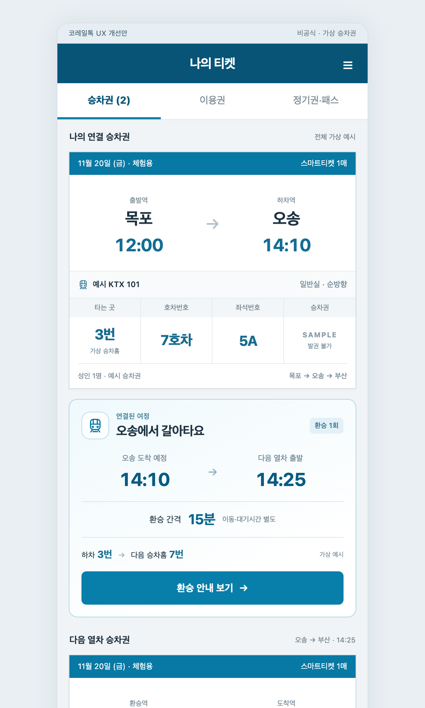
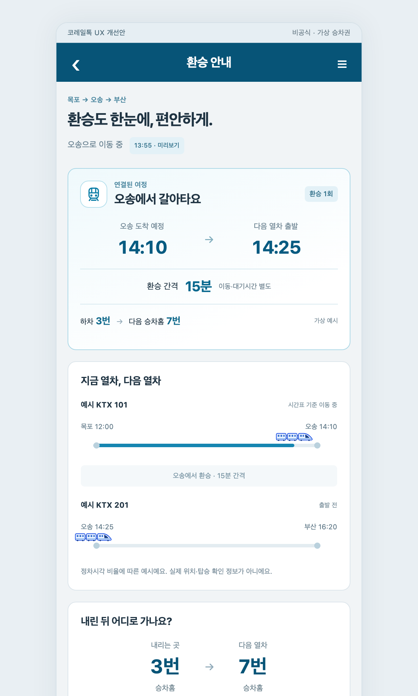

# 승차권에서 확인하는 오송역 환승 안내

**배포된 웹사이트:** <https://kiwisoop.github.io/ieum-rail-transfer/>

목포에서 부산으로 가는 승객이 첫 열차 안에서 승차권을 열면 오송 도착 예정시각, 다음 열차의 출발시각과 승차홈을 함께 확인하는 모바일 웹 프로토타입입니다. 휴먼컴퓨터인터페이스 과제 08이며, 승차권·지연 상황·시설 정보는 가상의 체험 자료입니다.

<p align="center">
  
  
</p>
<p align="center"><sub>왼쪽: 나의 티켓 · 오른쪽: 환승 안내</sub></p>

## 실행

Python 3가 필요하며 별도 패키지 설치는 필요하지 않습니다. 저장소 최상위 폴더에서 실행합니다.

```sh
python3 -m http.server 8080 --bind 127.0.0.1
```

[모바일 승차권 열기](http://127.0.0.1:8080/mobile/)

서버를 종료할 때는 터미널에서 Ctrl+C를 누릅니다. 소스는 `mobile/`과 상위 폴더의 공통 모듈(`routes.mjs`, `facilities.mjs`)에 있습니다.

## 사용할 수 있는 기능

- 목포 → 오송, 오송 → 부산 두 구간의 승차권과 체험 시각 기준 열차 진행 표시
- 환승 안내: 정상 도착 14:10, 다음 출발 14:25(간격 15분)
- 체험 설정에서 첫 열차를 10분 지연하면 도착 14:20, 환승 간격 5분으로 갱신
- 하차 후 시설 안내: 편의점 선택 시 바로 환승 도보 약 4분, 편의점을 거치면 약 8분
- 지연 상태에서 바로 환승 경로로 전환
- 시설 사진 확대와 층별 안내도(화살표·층 이동 버튼)로 다음 승차홈까지 경로 확인
- 현재 위치를 바꾸면 도보 예상시간 갱신

## 확인 순서

1. ‘나의 티켓’에서 두 구간의 승차권과 환승 안내를 확인합니다.
2. 체험 설정에서 첫 열차를 10분 지연시켜 환승 간격 변화를 봅니다.
3. 하차 후 시설 안내에서 편의점을 선택해 도보 시간을 비교합니다.
4. 시설 사진과 층별 안내도로 승차홈까지 경로를 살펴봅니다.

## 구현과 한계

OpenAI Codex로 HTML·CSS·JavaScript를 구현했습니다. 시설 사진의 출처와 경로 가정은 `mobile/README.md`에 기록했습니다. 도보 예상시간은 평지 보행과 층간 이동을 합산한 예시이며 시설 이용과 대기 시간은 제외합니다. 실측 동선, 실제 환승 성공률, 사용자 판단시간 개선 효과는 후속 검증 대상입니다.

## 검증

```sh
node mobile/tests.mjs
```

환승 간격(정상 15분·지연 5분), 열차 위치, 경로 계산을 검사합니다. 외부 API나 서버는 사용하지 않습니다.

## 제출 자료

[소스 코드 및 실행 링크](LINKS.md) · [프로젝트 설명 및 주요 기능 요약](PROJECT.md)
